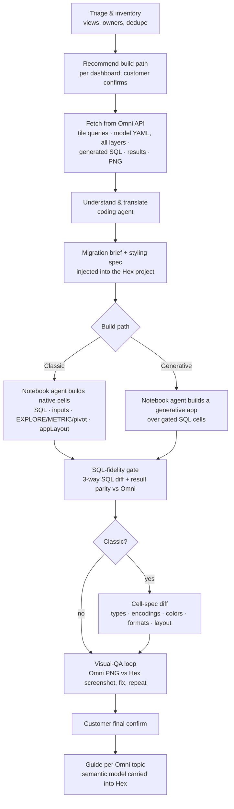

# How the Omni → Hex migration skill works

This is the human-facing explainer: what the skill does, why it's built this way, and
what happens at each step. The agent's step-by-step playbook is [`SKILL.md`](SKILL.md);
detail lives in [`reference/`](reference/).

## In one paragraph

A coding agent (Claude Code) reads an Omni dashboard through Omni's API: its tile
queries, every layer of the semantic model, and **Omni's own generated SQL and result
rows for each tile**. It works out what each tile means in plain SQL terms and writes a
precise **migration brief** into a Hex project. Hex's in-product **notebook agent**,
which can see the live warehouse and the workspace, builds the dashboard from that brief
as either a **classic Hex app** (native cells) or a **generative app** (a code app). The
form is chosen per dashboard. The coding agent then **verifies** the build. The SQL is
diffed against Omni's SQL and the numbers are tied to Omni's results. On the classic
path the chart specs are checked mechanically, and on both paths the rendered app is
screenshot-diffed against Omni's own render.

## The flow

## Why it's built this way

**1. Omni tiles have no SQL, so the hard part is compiling them correctly.**
An Omni tile is a semantic query: "these fields, from this topic, with these filters."
Omni turns it into SQL at run time using the model (views, measures, topics, joins). So
the Hex version is a *compilation* of that query, not a copy-paste. The usual mistakes
are:
- dropping a topic's always-on filters
- double-counting across a one-to-many join (Omni corrects for this; naive SQL doesn't)
- missing a field defined only in that dashboard's workbook model
- getting a relative-date window or its timezone wrong

The skill's reference docs list every one of these traps.

**2. Omni gives better verification anchors than any other BI tool, and the skill uses
both.**
- **Omni's own SQL.** Running a tile's query with `planOnly: true` returns the exact SQL
  Omni generates. The agent captures it for every tile and diffs the Hex SQL against it.
- **Omni's own results.** Running the same query returns its rows. If Hex points at the
  same warehouse, the Hex numbers must tie to Omni's exactly. "Does the SQL look right?"
  becomes "do the numbers match?"

**3. Two agents, each doing what it's good at.**

| | Coding agent (Claude Code) | Hex notebook agent |
|---|---|---|
| **Sees** | the Omni export, model YAML, Omni's SQL and results | the live warehouse schema and data, workspace context, its own render |
| **Owns** | understanding the dashboard; verifying the result | building it in Hex |
| **Costs** | model tokens | Hex credits |

Accuracy doesn't rely on trusting the builder. The gates review the SQL whoever wrote it.

**4. The data layer is always native, inspectable SQL.**
On both paths the numbers live in ordinary Hex SQL cells that pass the fidelity gate. The
charts (classic) or the app code (generative) only *read* those dataframes and never
query the warehouse themselves. That keeps every number on the dashboard inside the gate.

## Classic app vs. generative app

The customer chooses per dashboard. The skill recommends one and asks once for the
whole wave.

| | **Classic app** | **Generative app** |
|---|---|---|
| What gets built | native Hex cells (SQL, inputs, EXPLORE/METRIC/pivot charts) arranged in an app layout | a code app reading the gated SQL dataframes |
| Good fit | the typical Omni grid of charts, tables and KPIs; teams who'll maintain it themselves | dashboards heavy on markdown/HTML tiles, custom Vega-Lite, a branded or embedded look, data stories |
| Editable by analysts | yes, click-to-edit cells | no, it's code |
| How look and feel is verified | **cell-spec diff** (chart specs checked mechanically in the exported YAML) **plus** the render diff | render diff only |
| Limits | native cells can't compute ratios in-chart (done in SQL); maps and custom vis become Python cells; custom CSS doesn't carry over | very few, since it's code |

**Default when unsure: classic.** It's easier to maintain and better verified.

The form is set purely by the prompt the coding agent sends to Hex's notebook agent;
there's no CLI flag for it. So after every build the agent checks the export
(`genAppFiles` empty means classic, non-empty means generative) and re-prompts if it got
the wrong one.

## Step by step

**0. Triage (before anything is migrated).** `omni_fetch.py --list` ranks every
dashboard by views. The customer sorts them into migrate, archive, or drop, and merges
duplicates. The agent recommends a build path per dashboard and flags known gaps up
front: AI summary tiles, row-level access filters, uploaded spreadsheets, and tiles that
were silently capped at 1,000 rows.

**1. Pilot 1–2 dashboards end to end**, then tune the playbook before batching the rest.

**2. Fetch.** For each dashboard, `omni_fetch.py` saves:
- the tile queries
- the dashboard document (tiles, vis config, filters, layout)
- the export (workbook-level model changes, color palettes, uploads)
- the model YAML for every layer
- the connections list
- **Omni's generated SQL for every tile**
- optionally (`--results --png`), every tile's result rows and Omni's rendered PNG

**3. Understand and translate.** The coding agent:
- resolves every field through the model layers (tile → workbook → shared)
- compiles each tile's query, including joins, fan-out handling, topic filters, tile
  filters, sorts, limits and pivots
- maps dashboard filters to Hex inputs, including which tiles each filter skips or
  retargets
- turns Excel-style calculations into SQL window functions
- groups tiles into a few shared SQL cells instead of one query per tile

**4. Brief.** It writes a migration brief and a styling spec (titles, chart types,
encodings, hex colors, formats, grid positions) into the Hex project as markdown cells.

**5. Build.** It starts a Hex notebook-agent thread with the path's prompt and hands the
customer the **live URL**, so they can watch and redirect the build. For subtle models
it builds and gates the SQL cells first, starting from Omni's own SQL, so the
notebook agent only builds the presentation.

**6. SQL-fidelity gate.** For every SQL cluster, the agent:
- writes a translation ledger (source → target)
- has an independent subagent re-derive the SQL from the source
- does a three-way diff: subagent's SQL vs. built SQL vs. Omni's SQL
- runs a checklist of the known mistakes
- runs **result parity**: Hex rows vs. Omni rows, at default filters and with each
  filter changed once

**7. Cell-spec diff (classic only).** Every chart cell's type, encodings, date axes,
formats, colors and layout slot are checked against the styling spec in the exported
YAML, before anything is rendered.

**8. Visual QA.** Omni's rendered PNG is compared tile by tile with a headless
screenshot of the Hex app. Fixes go back to the notebook agent as one numbered batch per
round, until a round finds nothing. Then the customer gives the final sign-off.

**9. Carry the semantic layer across.** For each Omni topic, the agent publishes a Hex
guide covering canonical measures with their SQL, join and fan-out rules, always-on
filters, and risk areas. Hex Threads and the notebook agent then answer new questions the
way Omni would have. If metrics must be exact, the measures can also go into a Hex
semantic model.

## What carries over, and what doesn't

| Omni feature | In Hex |
|---|---|
| Charts, tables, KPIs, pivots | ✅ both paths |
| Dashboard filters, metric and timeframe switchers | ✅ Hex inputs, with per-tile scope |
| Topic always-on filters, joins, measures | ✅ compiled into SQL; documented in the guide |
| Excel-style calculations | ✅ as SQL window functions |
| Markdown tiles with live values | ✅ generative; 🔸 classic (values yes, custom CSS no) |
| Custom Vega-Lite, heatmaps, sankeys, maps | ✅ generative; 🐍 Python cells on classic |
| Cross-filtering | 🔸 best-effort |
| Row-level access filters | ⚠️ needs a decision (warehouse RLS or a viewer-bound input); never silently dropped |
| AI summary tiles | ⚠️ no SQL equivalent; agree a substitute |
| Spreadsheet tiles and uploads | ⚠️ ask the customer for the source data |

## What you need

- An Omni **Organization API key**. A personal token works for everything except the
  dashboard export.
- The Hex CLI, the target Hex data connection, and the headless-agent-threads feature.
  The build spends Hex credits.
- Playwright and a one-time Hex login in a browser for the screenshot loop.

## Known limits of this version

- The export and v2 document endpoints are partly undocumented or beta. The fetch script
  saves raw JSON, so nothing is lost if a field moves, but expect to adjust parsing.
- The Omni screenshot selectors in `omni_shots.py` haven't been checked against a live
  instance yet. The PNG download API is the primary source of the reference image.
- Nothing here has been run against a live Omni instance yet. The first pilot is also
  the skill's first real test.
